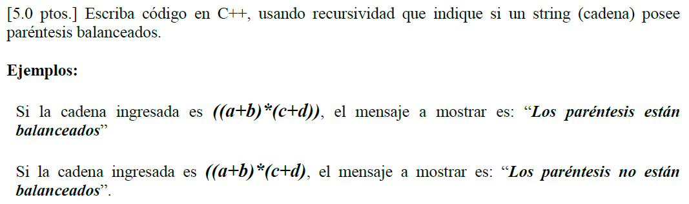

# Laboratorio 02

**Temas:** Recursividad, iteración, algoritmos de ordenamiento y búsqueda I


## Instrucciones generales

1. Cada ejercicio debe resolverse en un archivo independiente:

   * `ejercicio01.cpp`, `ejercicio02.cpp`, …

2. **NO** se permite compilar manualmente con `g++`. Utilizar el `Makefile` adjunto

3. El código **DEBE**:

   * Compilar sin errores
   * Respetar el estándar **C++17**
   * Usar `-Wall -Wextra -Wpedantic`

---

# Ejercicio 1

Implementar una función iterativa y otra recursiva que permita sumar los dígitos de un número entero. Si `n` es negativo?

---

# Ejercicio 2

Dado un número entero `n ≥ 0`, calcula el término `n` de la sucesión de Fibonacci:

```id="fibdef"
F(0) = 0  
F(1) = 1  
F(n) = F(n-1) + F(n-2)
```

Implementa tres versiones:

1. Recursiva **ingenua**
2. Iterativa
3. Recursiva **eficiente (con memoria)**


#### Ejemplo 

```text
Entrada:
5     (45 ?)

Salida:
5
```
---

# Ejercicio 3

Dado un arreglo de enteros:

```text
a₀, a₁, a₂, ..., aₙ
```

Se define la fracción continua:

```text
a₀ + 1/(a₁ + 1/(a₂ + 1/(... + 1/aₙ)))
```

Implementa una función recursiva que calcule su valor.

---

```text
Entrada:
n
a0 a1 a2 ... an
```

---

```text
Salida: 
Valor de la fracción (tipo `double`)
```
---

## Ejemplo

```text
Entrada:
2
1 2 2

Salida:
1.4
```
---


# Ejercicio 4

Dado un arreglo de enteros positivos:

```text
a₀, a₁, a₂, ..., aₙ₋₁
```

y un número objetivo `S`, encuentra **todos los subconjuntos** cuyos elementos sumen exactamente `S`.

---

## Entrada

```text
n S
a0 a1 a2 ... a(n-1)
```

---

##  Salida

Imprimir todos los subconjuntos que cumplen la condición.

Cada subconjunto en una línea.

---

### Ejemplo 

```text
Entrada:
4 5
1 2 3 4
```

```text
Salida:
1 4
2 3
```
---

# Ejercicio 5

Se tiene una lista de estudiantes:

```text
nombre, edad, nota
```

Ordenar la lista con el siguiente criterio:

1. Mayor nota
2. Menor edad (en caso de empate en nota)
3. Mantener orden original si ambos coinciden (estabilidad). Use burbuja o inserción.

---

# Ejercicio 6

Se tiene el siguiente algoritmo de ordenamiento:

```cpp
for (int i = 0; i < n-1; i++) {
    int minIndex = i;
    for (int j = i+1; j < n; j++) {
        if (valor[j] < valor[minIndex])
            minIndex = j;
    }
    // intercambio
    int temp = valor[i];
    valor[i] = valor[minIndex];
    valor[minIndex] = temp;
}
```

Cada elemento del arreglo tiene dos atributos:

* `valor[i]` -> el valor por el cual se ordena
* `id[i]` -> posición original del elemento

Estos se almacenan en **dos arreglos paralelos**:

```cpp
int valor[n];
int id[n];
```

---

1. Construir un caso de prueba donde el algoritmo:

   * cambie el orden relativo de elementos con el mismo `valor`
2. Ejecutar el algoritmo paso a paso 
3. Explicar claramente **por qué ocurre el cambio**

---

## Ejemplo:

```text
valor:  3   3   1
id:     A   B   C
```

Después de ordenar:

```text
valor:  1   3   3
id:     C   B   A   <- cambió el orden relativo
```

* ¿Por qué `A` y `B` cambiaron de orden si tenían el mismo valor?
* ¿En qué línea del algoritmo ocurre el problema?
* ¿Este algoritmo es estable? Justifica.

    Un algoritmo es estable si **no altera el orden relativo de elementos iguales**

* Modifica el algoritmo para que:

    * Siga siendo Selection Sort
    * Pero ahora sea **estable**


---

# Ejercicio 7 

Dado un arreglo de `n` elementos, se sabe que: Solo los primeros `k` elementos más pequeños importan (k << n)

---

1. Modificar Selection Sort para encontrar SOLO los `k` menores
2. Explicar por qué es más eficiente que ordenar todo

---

# Ejercicio 8

Se tiene un arreglo de estudiantes:

```text
nombre, nota
```

Se desea encontrar el **primer estudiante** que cumpla:

```text
nota ≥ promedio del arreglo
```
---

1. Calcular el promedio
2. Aplicar búsqueda lineal con esa condición

---

