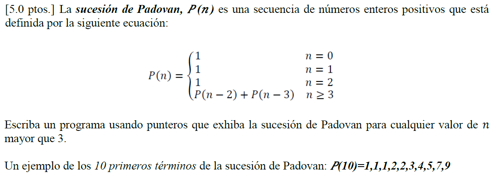
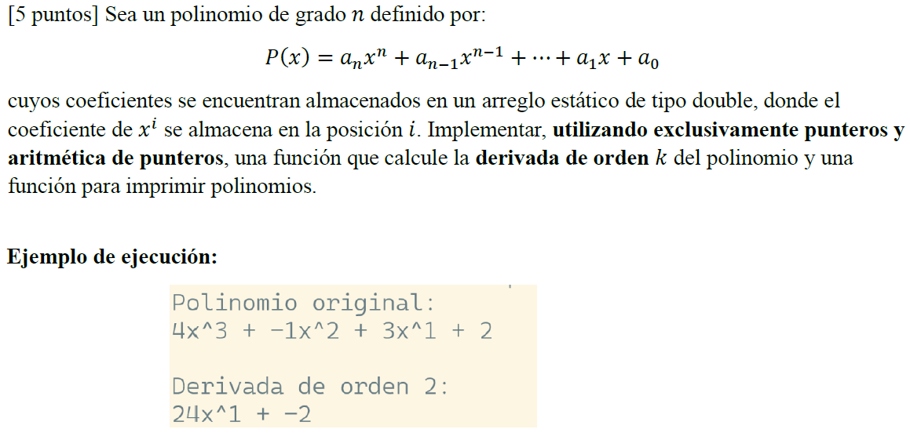
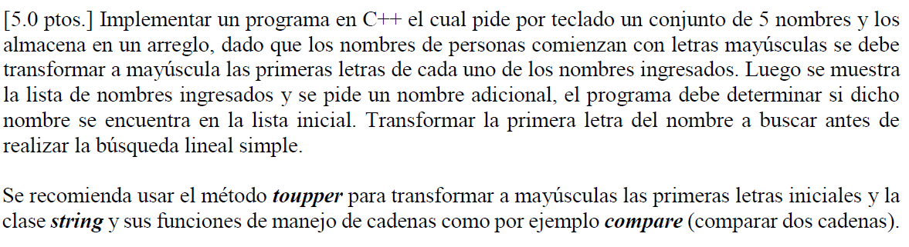
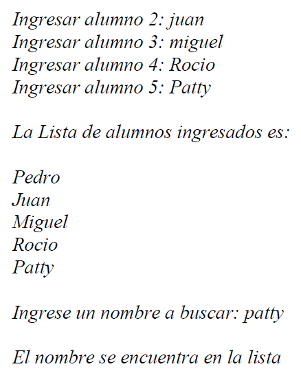

# Laboratorio 6: Manipulación de Arreglos de Caracteres y Cadenas con Punteros en C++

---

## Ejercicio 1 — Longitud de una cadena con punteros
 
Escribe una función `int longitud(const char* s)` que reciba un puntero a una cadena de caracteres terminada en `'\0'` y retorne su longitud **sin usar índices de arreglo**. Solo puedes avanzar el puntero con `++` o `+`.

**Ejemplo:**
```
Entrada: "Hola mundo"
Salida:  10
```
---

## Ejercicio 2 — Invertir una cadena (in situ)
 
Escribe la función `void invertir(char* s)` que invierta el contenido de la cadena **en el mismo arreglo** (sin usar un arreglo auxiliar). Debes usar dos punteros: uno que apunte al inicio y otro al final, e intercambiar sus valores acercándolos hacia el centro.

**Ejemplo:**
```
Entrada: "programar"
Salida:  "ramargorp"
```
---

## Ejercicio 3 — Contar ocurrencias de un carácter

Escribe la función `int contarCaracter(const char* s, char c)` que cuente cuántas veces aparece el carácter `c` dentro de la cadena `s`, recorriendo solo con aritmética de punteros.

**Ejemplo:**
```
Entrada: "mississippi", 's'
Salida:  4
```

---

## Ejercicio 4 — Copiar cadena con punteros

Implementa `void copiar(char* destino, const char* origen)` que copie todos los caracteres de `origen` hacia `destino`, incluyendo el `'\0'` final. No usar índices; avanza ambos punteros simultáneamente con asignación y desreferencia.

**Ejemplo:**
```
Entrada: origen:  "C++ es poderoso"

Salida: destino: (arreglo vacío de tamaño suficiente)
        destino: "C++ es poderoso"
```

---

## Ejercicio 5 — Comparar dos cadenas lexicográficamente
 
Escribe `int comparar(const char* a, const char* b)` que retorne:
- `0` si las cadenas son iguales
- Un valor negativo si `a` es lexicográficamente menor que `b`
- Un valor positivo si `a` es mayor que `b`

**Ejemplo:**
```
comparar("apple", "apply")  retorna  negativo  (e < y)
comparar("hola", "hola")    retorna  0
comparar("z", "a")          retorna  positivo
```
---

## Ejercicio 6 — Eliminar espacios en blanco de una cadena
 
Escribe `void eliminarEspacios(char* s)` que modifique la cadena in situ eliminando **todos** los espacios en blanco (`' '`). Usa un puntero de lectura y otro de escritura sobre el mismo arreglo.

**Ejemplo:**
```
Entrada: "  hola   mundo  "
Salida:  "holamundo"
```
---

## Ejercicio 7 — Buscar una subcadena (implementación de `strstr`)

Implementa `const char* buscarSubcadena(const char* texto, const char* patron)` que retorne un puntero a la **primera** ocurrencia del `patron` dentro de `texto`, o `nullptr` si no existe.

**Ejemplo:**
```
buscarSubcadena("El lenguaje C++ es genial", "C++")  el retorno apunta a "C++ es genial"
buscarSubcadena("hola mundo", "xyz")                 retorna  nullptr
```
---

## Ejercicio 8 — Convertir a mayúsculas/minúsculas


Escribe dos funciones:
- `void aMayusculas(char* s)`: convierte toda la cadena a mayúsculas.
- `void aMinusculas(char* s)`: convierte toda la cadena a minúsculas.

Debe manipular directamente los códigos ASCII: las minúsculas están entre `'a'` (97) y `'z'` (122); las mayúsculas entre `'A'` (65) y `'Z'` (90). La diferencia entre ambas es 32.

**Ejemplo:**
```
aMayusculas("Hola Mundo 123")  salida  "HOLA MUNDO 123"
aMinusculas("PROGRAMAR en C++")  salida "programar en c++"
```

---

## Ejercicio 9 — Tokenizar una cadena por un delimitador
 
Escribe `char* siguienteToken(char** cursor, char delimitador)` que funcione como un tokenizador manual. Recibe un **puntero a puntero** (`char**`) que actúa como cursor. En cada llamada, debe:
1. Retornar un puntero al inicio del siguiente token.
2. Reemplazar el delimitador encontrado con `'\0'` para terminar el token.
3. Avanzar el cursor al carácter siguiente después del delimitador.
4. Retornar `nullptr` cuando no haya más tokens.

**Ejemplo:**
```
Cadena original: "rojo,verde,azul,amarillo"
Llamada 1 → "rojo"
Llamada 2 → "verde"
Llamada 3 → "azul"
Llamada 4 → "amarillo"
Llamada 5 → nullptr
```
---

## Ejercicio 10 — Validar y parsear un número entero desde una cadena

Escribe `bool cadenaAEntero(const char* s, int& resultado)` que convierta una cadena de texto a un entero. La función debe:
- Ignorar espacios al inicio.
- Aceptar un signo opcional (`+` o `-`).
- Convertir los dígitos a su valor numérico.
- Retornar `false` si la cadena no representa un número válido (contiene letras, está vacía después de espacios, etc.).
- Retornar `true` y almacenar el resultado en `resultado` si es válida.

**Ejemplo:**
```
cadenaAEntero("  -427", resultado)   retorna  true,  resultado = -427
cadenaAEntero("+88", resultado)      retorna  true,  resultado = 88
cadenaAEntero("12abc", resultado)    retorna  false
cadenaAEntero("   ", resultado)      retorna  false
```
---

## Ejercicio 11: Conteo de palabras con punteros

Dada una cadena de caracteres terminada en `'\0'`, implementar una función que determine cuántas palabras contiene.

Una palabra se define como una secuencia continua de caracteres distintos del espacio (' ').

El algoritmo debe ser capaz de manejar correctamente:

* Espacios al inicio y al final
* Múltiples espacios consecutivos entre palabras
* Cadenas vacías o con solo espacios


**Ejemplo: **
```
Entrada: "Hola mundo desde C++"
Salida: 4


Entrada: "   Hola     mundo   "
Salida: 2
```


## 12. Compresión básica de cadena

Dada una cadena de caracteres terminada en `'\0'`, implementar una función que genere una nueva cadena comprimida utilizando el conteo de repeticiones consecutivas.

El formato de compresión consiste en reemplazar cada grupo de caracteres repetidos por el carácter seguido de la cantidad de veces que aparece de forma consecutiva.

Por ejemplo, la cadena `"aaabbc"` se transforma en `"a3b2c1"`.

Asumir que la cantidad de repeticiones es de un solo dígito (1–9)


**Ejemplo:**
```
Entrada:
"aaabbc"

Salida:
"a3b2c1"
```
---

## 13. Rotación de cadena

Dada una cadena de caracteres terminada en `'\0'` y un entero positivo `k`, implementar una función que rote la cadena `k` posiciones hacia la derecha.

Rotar una posición a la derecha implica que el último carácter pasa a ser el primero.

El algoritmo debe considerar que `k` puede ser mayor que la longitud de la cadena.

- La rotación debe hacerse de forma lógica (no imprimir directamente sin modificar la cadena)


**Ejemplo:**
```
Entrada:
Cadena: "abcdef"
k = 2

Salida:
"efabcd"
```
---


## 14. Verificación de anagramas

Dadas dos cadenas de caracteres terminadas en `'\0'`, implementar una función que determine si ambas son anagramas entre sí.

Dos cadenas son anagramas si contienen exactamente los mismos caracteres con la misma frecuencia, sin importar el orden.


- Se deben considerar todos los caracteres (incluyendo letras mayúsculas y minúsculas como diferentes)
- No ignorar espacios (si existen, deben coincidir en cantidad)
---

**Ejemplo:**
```
Entrada:
Cadena 1: "roma"
Cadena 2: "amor"

Salida: true


Entrada:
Cadena 1: "hola"
Cadena 2: "hale"

Salida: false
```


## 15. Mayor palabra en una cadena

Dada una cadena de caracteres terminada en `'\0'`, implementar una función que identifique y muestre la palabra más larga contenida en ella.

El algoritmo debe manejar correctamente:

- Múltiples espacios consecutivos
- Espacios al inicio y al final
- Cadenas con una sola palabra

Si existen varias palabras con la misma longitud máxima, mostrar la primera que aparece.

- No crear arreglos auxiliares innecesarios (resolver con lógica de recorrido)


**Ejemplo:**
```
Entrada:
"La Programacion en C++ es poderosa"

Salida:
"Programacion"


Entrada:
"hola mundo cruel"

Salida:
"mundo"
```

## Ejercicios de evaluación










